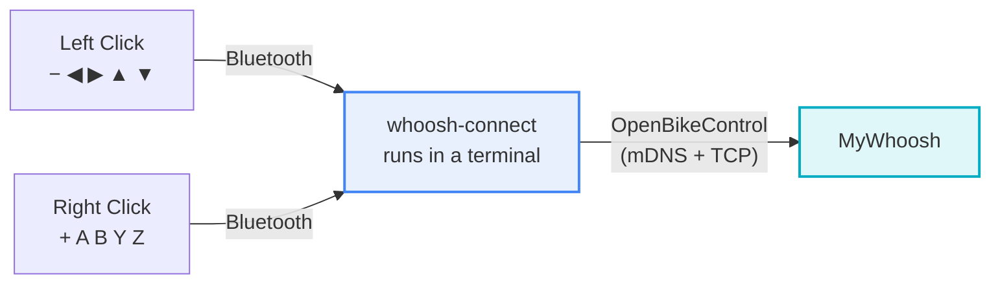

<h1 align="center">whoosh-connect</h1>

<p align="center">
  <strong>Use Zwift Click&nbsp;v2 shifters in MyWhoosh — without Zwift.</strong><br/>
  No phone · no Zwift app · no daily unlock dance.
</p>

<p align="center">
  <a href="https://github.com/tusharpandey13/whoosh-connect/blob/main/LICENSE"></a>
  <a href="#"></a>
  <a href="#"></a>
  <a href="#"></a>
</p>

See https://tusharpandey.com/blogs/whoosh-connect/

> Right **`+`** shifts up, left **`−`** shifts down, and the rest of the buttons
> steer, navigate menus, and switch camera — through a small program that turns
> your Click pucks into an OpenBikeControl device MyWhoosh already understands.



Verified on a real bike: **macOS · MyWhoosh 5.7.0 · Click v2 firmware 1.2.0 ·
Van Rysel D-series trainer.** A full ride, gear changes included.

---

## ✨ What you get

- **Zero config** — pair nothing, set nothing up; the defaults match how most
  people ride.
- **One puck is enough** — the left puck relays the right puck's buttons too.
- **No Zwift** — the pucks talk straight to your Mac; MyWhoosh never knows the
  difference.
- **No subscription, no cloud** — everything runs locally, offline.
- **Keyboard fallback** — one flag switches the output to keystrokes if you'd
  rather test or use a different game.

## 🚀 Quick start

**You need:** a Mac, Python 3.11+, MyWhoosh, and one or both Click v2 pucks.

```bash
git clone https://github.com/tusharpandey13/whoosh-connect.git
cd whoosh-connect
make install                 # creates .venv and installs the dependencies
```

Then, for every ride:

1. **Quit Zwift** if it's open — it grabs the pucks.
2. **Start the bridge:**

   ```bash
   .venv/bin/whoosh-connect run
   ```

3. **Press any button on a Click** to wake it. You should see:

   ```text
   21:03:11 Clicks connected (left puck 2D7E, battery 80 %)
   ```

4. **In MyWhoosh:** open the connection screen → tap **OpenBikeControl** → pick
   **whoosh-connect**. The bridge prints:

   ```text
   21:03:40 MyWhoosh connected (app mywhoosh …)
   ```

5. **Ride.** Ctrl-C stops the bridge cleanly.

> **First run only:** macOS asks whether your terminal may use Bluetooth — say
> yes (System Settings → Privacy & Security → Bluetooth).

## ⚡ Run without a terminal

You don't have to keep a Terminal window open for the whole ride. Pick one
way to run:

| Command | What it does | Good for |
|---|---|---|
| `make ride` | run in the foreground, Ctrl-C to stop | watching the logs |
| `make ride-bg` | start in the background, log to a file, `make stop` to stop | closing the terminal |
| `make install-launchd` | start at login, restart on crash, no terminal at all | set-and-forget |

```bash
make ride-bg                                  # starts detached; you can close the terminal
tail -f ~/Library/Logs/whoosh-connect/ride.log  # watch what it's doing
make stop                                     # stop a ride-bg bridge
```

To run automatically every time you log in (optional, and reversible):

```bash
make install-launchd    # start now + at every login
make uninstall-launchd  # stop it and remove the login item
```

`make stop` also halts a running login agent until your next login; to remove
it permanently, use `make uninstall-launchd`.

> **Bluetooth permission, launchd edition:** the login agent runs under
> Python, not your terminal, so macOS may ask to let **python** use Bluetooth
> on first start. If it exits with code 3 (`Bluetooth unavailable`), approve
> Python under System Settings → Privacy & Security → Bluetooth, then run
> `make install-launchd` again.

## 🎮 Controls

No configuration needed. The mapping below is the default.

| Click | Button | Action |
|:-----:|:------:|--------|
| **right** | `+` | **Gear up** |
| **left**  | `−` | **Gear down** |
| left  | ◀ ▶ | Steer left / right (hold) |
| left  | ▲ ▼ | Navigate up / down |
| right | A | Select |
| right | B | Back |
| right | Y | Camera view |
| right | Z | Menu |

One tap = one gear. Gears move **during a ride** (not on the connection screen),
and MyWhoosh still needs a virtual-shifting-capable trainer paired for the gear
number to change.

## 🛟 Troubleshooting

| You see… | What it means | Fix |
|---|---|---|
| `Press a Click button to wake it` (repeats) | the puck sleeps until touched | press a button on the puck |
| buttons print, the game ignores them | MyWhoosh isn't attached yet | connection screen → **OpenBikeControl** → **whoosh-connect** |
| `no app connected; dropping …` | same, seen from the bridge | as above |
| everything stops after ~1 minute | the puck's own idle timeout | press a button — each press buys ~50 s |
| `Click is awake but quiet (ff 03 seen)` | informational, not an error | keep riding; press if you want more |
| `another whoosh-connect run is still alive` | one bridge per machine | `pkill -f 'whoosh[-]connect'`, then start once |
| exit code 3 | Bluetooth off, or the terminal lacks permission | see the permission note above |

Still stuck? `-v` prints the raw traffic: `.venv/bin/whoosh-connect -v run`.

## 🧰 Commands

```bash
whoosh-connect run                     # the bridge (what you want)
whoosh-connect run --capture ride.jsonl    # also record the ride for debugging
whoosh-connect run --sink keyboard     # fallback: send K/I/A/D keystrokes instead
whoosh-connect replay ride.jsonl       # replay a recording, no Bluetooth needed
whoosh-connect unlock                  # optional: one Zwift pairing, longer windows
whoosh-connect dlock --live --push     # research: answer the puck's unlock request
```

`-v` = verbose. Exit codes: `2` bad usage/config, `3` Bluetooth unavailable,
`4` no free port, `5` the unlock service signed nothing, `6` another bridge is
already running.

## ⚙️ Configuration

Optional. Create `~/.config/whoosh-connect/config.toml`:

```toml
[map]
SHIFT_R = "SHIFT_UP"      # right +
SHIFT_L = "SHIFT_DOWN"    # left -
Z       = "NONE"          # disable a button
```

Available actions: `SHIFT_UP SHIFT_DOWN GEAR_SET UP DOWN LEFT RIGHT SELECT BACK
MENU HOME STEER_LEFT STEER_RIGHT CAMERA HUD`, or `NONE`.

## 🔬 How it works

1. **Talk to the pucks.** The Click v2 speaks a simple Bluetooth protocol: one
   notification per button change, sent as a bitmask. No pairing, no encryption.
2. **Turn buttons into actions.** Each change is diffed against the previous
   state (a hold is one press, not a hundred) and mapped to an
   [OpenBikeControl](https://github.com/OpenBikeControl/openbikecontrol-protocol)
   action — the protocol MyWhoosh already speaks.
3. **Serve it to the game.** The bridge advertises itself over mDNS, accepts
   MyWhoosh's connection, answers its heartbeat, and streams the actions.

<details>
<summary>About the Click's "daily unlock"</summary>

Zwift's pucks ask their cloud for a signed "you may report buttons" token once a
day. That request does **not** stop buttons from working here: a press opens a
~50 s window in which everything is reported, and pressing again opens the next
one. `whoosh-connect unlock` (a single Zwift pairing) only makes those windows
longer.

The full investigation — captures, the challenge format, what did and didn't
work — is in [notes/unlock-analysis.md](notes/unlock-analysis.md) and
[docs/hardware.md](docs/hardware.md).
</details>

## 📚 Documentation

| Where | What |
|---|---|
| [docs/hardware.md](docs/hardware.md) | measured protocol: GATT, frames, button bits, challenge format |
| [docs/journey.md](docs/journey.md) | the end-to-end user and system journey, failure paths |
| [docs/dev-spec.md](docs/dev-spec.md) | module-by-module design |
| [docs/test-spec.md](docs/test-spec.md) | what the tests cover |
| [notes/unlock-analysis.md](notes/unlock-analysis.md) | the unlock investigation, with corrections |
| [notes/bikecontrol-protocols.md](notes/bikecontrol-protocols.md) | prior-art analysis (BikeControl and friends) |
| [raw/](raw/) | the captures behind every claim, including the working ride |

## 🧑‍💻 Development

```bash
make test     # fully offline: no Bluetooth, no network, no Zwift, no MyWhoosh
make lint
```

Tests never inject keystrokes on purpose — a stray `K` would really shift the
rider's gear mid-ride.

## 🗺️ Roadmap / open questions

Two research questions are tracked in [TODO.md](TODO.md): why the signable
58-byte unlock challenge only appears sometimes, and why the right puck stays
dormant. Neither blocks riding.

## 🙏 Credits

Protocol knowledge comes from
[BikeControl](https://github.com/jonasbark/swiftcontrol),
[clickbridge](https://github.com/jasasonc/clickbridge),
[zwoosh](https://github.com/amith2368/zwoosh) and the
[OpenBikeControl spec](https://github.com/OpenBikeControl/openbikecontrol-protocol).

Not affiliated with Zwift or MyWhoosh. [MIT](LICENSE) licensed.
